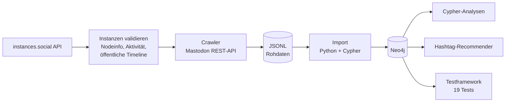
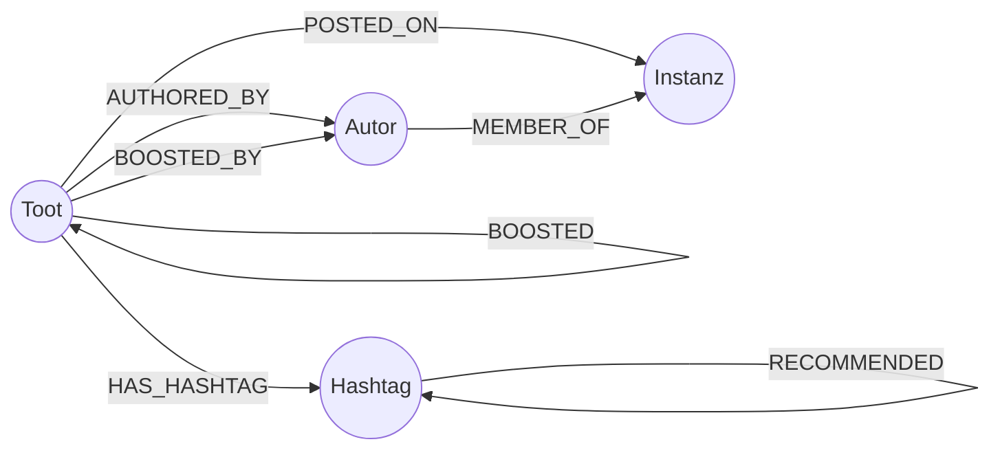

# MastodonNeo

Bachelorarbeit, ZHAW School of Management and Law
BSc Wirtschaftsinformatik, Vertiefung Data Science, 2026

**Automatisierte Erfassung und Analyse wissenschaftlicher Mastodon-Kommunikation mit Neo4j**

> **English summary:** A Python data pipeline that discovers and validates science-related Mastodon instances, crawls public posts (toots) across 43 instances, and loads them into a Neo4j graph database. The graph enables cross-instance analyses that Mastodon's built-in search cannot provide, such as hashtag co-occurrence, reply networks and boost propagation. Includes a graph-based hashtag recommender and a test suite with 19 checks for data integrity.

---

## Worum es geht

Wissenschaftliche Kommunikation auf Mastodon ist über viele unabhängige Server (Instanzen) verteilt. Die eingebaute Suche sieht immer nur einen Ausschnitt. Dieses Projekt sammelt Toots von mehreren wissenschaftlichen Instanzen automatisiert ein und führt sie in einer Graphdatenbank zusammen. Damit werden Fragen beantwortbar wie: Welche Hashtags treten gemeinsam auf? Wer antwortet wem über Instanzgrenzen hinweg? Wie verbreiten sich Beiträge über Boosts?

Das Vorgehen folgt der Design Science Research Methodology (DSRM) nach Peffers et al. (2007).

## Pipeline



1. **Instanzen finden und validieren:** Kandidaten von instances.social, technische Prüfung über Nodeinfo, Aktivitätsdaten und Erreichbarkeit der öffentlichen Timeline.
2. **Crawlen:** Toots pro Instanz über die Mastodon-API, inkl. Nachladen fehlender Reply-Ziele und Abruf der Boost-Daten. Mit Pausen zwischen den Anfragen und eigenem User-Agent.
3. **Zwischenspeichern:** Rohdaten als JSONL, damit Crawling und Import unabhängig voneinander laufen.
4. **Importieren:** Idempotenter Import mit `MERGE`, Unique Constraints und Volltextindex.
5. **Analysieren:** Cypher-Abfragen, Hashtag-Empfehlungen (Jaccard-Ähnlichkeit und gemeinsame Autoren), Validierung durch ein Testframework.

## Graphmodell



## Datensatz

| Kennzahl | Wert |
|---|---:|
| Validierte und gecrawlte Instanzen | 43 |
| Toots (mit URI) | 8'992 |
| Eindeutige Autoren | 3'119 |
| Instanz-Knoten im Graphen | 463 |
| Eindeutige Hashtags | 3'098 |
| HAS_HASHTAG-Kanten | 16'771 |
| BOOSTED_BY-Kanten | 2'158 |
| REPLY_TO-Kanten | 910 |
| Platzhalter-Knoten (nicht auflösbare Reply-Referenzen) | 172 |

Gecrawlt wurde von 43 Instanzen. Im Graphen entstehen trotzdem 463 Instanz-Knoten, weil Autoren und Boosts aus dem gesamten föderierten Netzwerk stammen.

Die Rohdaten sind nicht Teil des Repositorys. Sie enthalten Beiträge und Benutzernamen Dritter und können mit den Skripten selbst erhoben werden.

## Voraussetzungen

- Python 3.11
- Neo4j Desktop (Download: https://neo4j.com/download/)
- Git
- instances.social API-Token (optional, nur fuer Schritt 1a)

---

## Installation

### 1. Repository klonen

```bash
git clone https://github.com/IliasBro/MastodonNeo.git
cd MastodonNeo
```

### 2. Virtuelle Umgebung einrichten

```bash
python3.11 -m venv .venv
source .venv/bin/activate
pip install -r requirements.txt
```

### 3. Umgebungsvariablen konfigurieren

Erstelle eine `.env`-Datei im Root-Verzeichnis:

```
NEO4J_URI=bolt://localhost:7687
NEO4J_USER=neo4j
NEO4J_PASSWORD=dein_passwort
INSTANCES_SOCIAL_TOKEN=dein_token  # optional, nur fuer Schritt 1a
```

### 4. Neo4j Desktop starten

Starte Neo4j Desktop, lege eine neue Datenbank an und starte sie.
Installiere unter Plugins die Graph Data Science Library.

---

## Verwendung

### Schritt 1a: Instanzen abrufen (optional)

Wenn keine eigene Kandidatenliste vorhanden ist, kann `fetch_instances.py` automatisch wissenschaftliche Mastodon-Instanzen von instances.social abrufen. Dafuer wird ein API-Token benoetigt, der unter https://instances.social/api/token generiert werden kann. Die gewuenschten Suchbegriffe koennen im Script unter `KEYWORDS` angepasst werden.

```bash
python Instances/fetch_instances.py
```

Schreibt `Data/InstancesNotValidated.json` mit bis zu 60 Instanzen.

### Schritt 1b: Instanzen validieren

```bash
python Instances/validate_instances.py
```

Liest `Data/InstancesNotValidated.json` und schreibt `Data/InstancesValidated.json`.

### Schritt 2: Toots sammeln

```bash
python MastodonCrawler/Mastodoner.py
```

Schreibt `Data/ScrapedData_Mastodoner.jsonl` und `Data/BoostData.jsonl`.

### Schritt 3: In Neo4j importieren

```bash
python Neo4j/ImportToNeo4j.py
```

### Schritt 4: Volltext-Index erstellen

Im Neo4j Browser ausfuehren:

```cypher
CREATE FULLTEXT INDEX toot_content IF NOT EXISTS FOR (t:Toot) ON EACH [t.content]
```

### Schritt 5: Hashtag-Recommender ausfuehren

```bash
python Recommender/hashtag_recommender.py
```

### Schritt 6: Testframework ausfuehren

```bash
python Neo4j/test_framework.py
```

---

## Repository-Struktur

```
MastodonNeo/
├── Data/                          # Gesammelte Toots (nicht versioniert)
│   ├── BoostData.jsonl            
│   ├── InstancesNotValidated.json # Kandidatenliste
│   ├── InstancesValidated.json    # Validierte Instanzen              
│   ├── ScrapedData_BeautifulSoup.jsonl
│   ├── ScrapedData_Mastodoner.jsonl
│   └── ScrapedData_PublicApi.jsonl
├── Instances/
│   ├── fetch_instances.py         # Automatischer Instanzabruf (optional)
│   └── validate_instances.py      # Validierungsskript
├── MastodonCrawler/
│   └── Mastodoner.py              # Hauptcrawler inkl. Boost-Abruf
├── Neo4j/
│   ├── ImportToNeo4j.py           # Import-Skript
│   ├── test_framework.py          # Testframework (19 Tests)
│   └── cypher_queries.cypher      # Abfragesammlung
├── Recommender/
│   └── hashtag_recommender.py     # Hashtag-Empfehlungen
├── WebScraping/
│   ├── Scraping_PublicApi.py      # Unauthentifizierter Endpunkt
│   └── Scraping_BeautifulSoup.py  # HTML-Scraping-Diagnose
├── .env                           # Neo4j-Zugangsdaten (nicht versioniert)
├── README.md
└── requirements.txt
```

---

## Autor

Ilias Ehrensperger, ehrenili@students.zhaw.ch
Betreuer: Dr. Philipp Stalder, ZHAW School of Management and Law